# Cyclotron — Decision Flywheel

**Cyclotron is a self-aligning decision model harness.** It wraps a decision
model such as Jev with the parts that turn human feedback into an auditable,
improvable classifier.

Jev, Kev and Laya are third-party decision models, not people or placeholders:
Jev is TypeSafe AI's hosted System One model (reached through `typesafe-sdk`),
Kev is a decision model you run as a local server that speaks the same System One
API, and Laya is Convai Innovations' open-weight
[`convaiinnovations/laya`](https://huggingface.co/convaiinnovations/laya) model,
loaded in-process. Cyclotron ships an optional adapter for each; any model that
fits the adapter contract works the same way.

A decision model can give a fast structured answer. It does not know a team's
private definition of a good item. Cyclotron starts with a simple decision, then
uses human labels and explanations to make three controlled changes around the
model: an evolving rubric, a fixed few-shot example list, and supporting
questions. The answers to the main and supporting questions become features for
a small ML model. The ML model produces the decision and a calibrated
confidence.

The optimizer proposes changes. Code validates them, fits the numerical model,
and measures candidates before it changes what is active. It records the
requests, responses, feedback, versions, and measurements so a run can be
inspected later. It does not promise that every change improves a classifier.

## Use the core library without the workspace

The FastAPI/GraphQL workspace is an optional application. The core library does
not need FastAPI, GraphQL, React, or a running web server. An application gives
`DecisionFlywheel` a provider adapter and can observe its structured events.
With no optimizer, the flywheel supports prediction and tracing only. It refuses
an optimization request before it can make a provider call.

<!-- core-quickstart:start -->
```python
import asyncio

from decision_flywheel import ClassifierConfig, DecisionFlywheel
from decision_flywheel.classifier_config import ClassifiedAnswers
from decision_flywheel.models import DecisionResult, DecisionTask, Item


class ScriptedModel:
    """Replace this with JevAdapter, KevAdapter, LayaAdapter, or your adapter."""
    model_identity = "scripted-v1"

    async def classify(self, config, target, training, *, now=None, event_sink=None):
        answer = DecisionResult("include", {"include": 0.8, "exclude": 0.2})
        return ClassifiedAnswers({"decision": answer}, self.model_identity, {}, 0)


task = DecisionTask("library", ("include", "exclude"), "Should this item be included?")
wheel = DecisionFlywheel("local.sqlite3", ClassifierConfig(task), ScriptedModel())
prediction = asyncio.run(wheel.predict(Item("item-1", {"text": "A useful paper"}), ()))
print(prediction.label, prediction.confidence)  # include 0.8
print(wheel.history()[-1]["kind"])             # prediction
wheel.close()
```
<!-- core-quickstart:end -->

To enable structural optimization, inject an `OptimizerAgent` with an
application-owned completion callable. The core remains provider-neutral. The
adapter, storage choice, and event consumer are application decisions.

## Embed a cyclotron in an application

The full walk-through, with the widgets and operational notes, is
[docs/embedding.md](docs/embedding.md).

An application that already has items and reviewers uses four calls. It keys
everything by its own item identities. The cyclotron owns item partitions,
held-out reviews, selection propensities, versions and learning, and keeps
them in SQLite files under one directory.

<!-- embedded-quickstart:start -->
```python
import asyncio

from decision_flywheel import ClassifierSpec, Cyclotron, CyclotronDefinition, Item
from decision_flywheel.batched_classification import BatchedAnswers
from decision_flywheel.models import DecisionResult


class ScriptedModel:
    """Replace this with a batched decision-model adapter such as Jev."""
    model_identity = "scripted-batch-v1"

    async def classify_many(self, configs, target, training, **kwargs):
        answer = DecisionResult("include", {"include": 0.8, "exclude": 0.2})
        return BatchedAnswers({name: {"decision": answer} for name in configs}, self.model_identity, {}, 0)


relevant = ClassifierSpec("relevant", ("include", "exclude"),
                          "Is this source relevant to the publication?", positive_label="include")
definition = CyclotronDefinition("relevance", (relevant,))


async def main():
    with Cyclotron.open("var/relevance", definition, ScriptedModel()) as cyclotron:
        decision = await cyclotron.decide(Item("ref-1", {"text": "A vendor press release"}))
        print(decision.label, decision.confidence)
        await cyclotron.review(decision.decision_id, "exclude", explanation="Vendor marketing.",
                               reason_code="out_of_scope", reviewer="editor-1")
        print(cyclotron.status().to_json()["alignment"]["accuracy"])
        print([event["kind"] for event in cyclotron.subscribe(after=0)["events"]])

asyncio.run(main())
```
<!-- embedded-quickstart:end -->

## What Cyclotron adds around a decision model



The **LLM optimizer** proposes changes to language and structure: rubric,
examples, and supporting questions. The **ML fitter** learns numerical feature
weights and confidence calibration only from trusted labels. A candidate
becomes active only when its configured evaluation accepts it.

## Set up a cyclotron for a recurring decision

The setup and usage guide, built from our own runs, is [docs/using-cyclotron.md](docs/using-cyclotron.md). Read it before your first run.

## More documentation

- [Embedding walk-through, widgets and operational notes](docs/embedding.md)
- [Design journal: status, the classifier, feedback, evaluation, workspace](docs/design-journal.md)
- [Glossary](docs/glossary.md)
- [Cyclotron versioning and calibration](docs/cyclotron-versioning.md)
- [Hypothesis portfolio](docs/hypothesis-portfolio.md)
- [Diagrams](docs/diagrams/README.md)

## License

The repository code has an MIT license.
Downloaded datasets and model weights retain their upstream terms.
